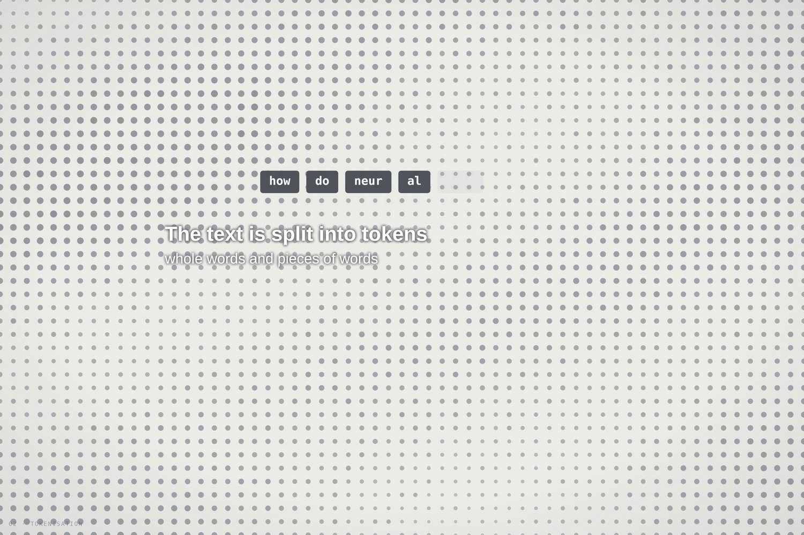
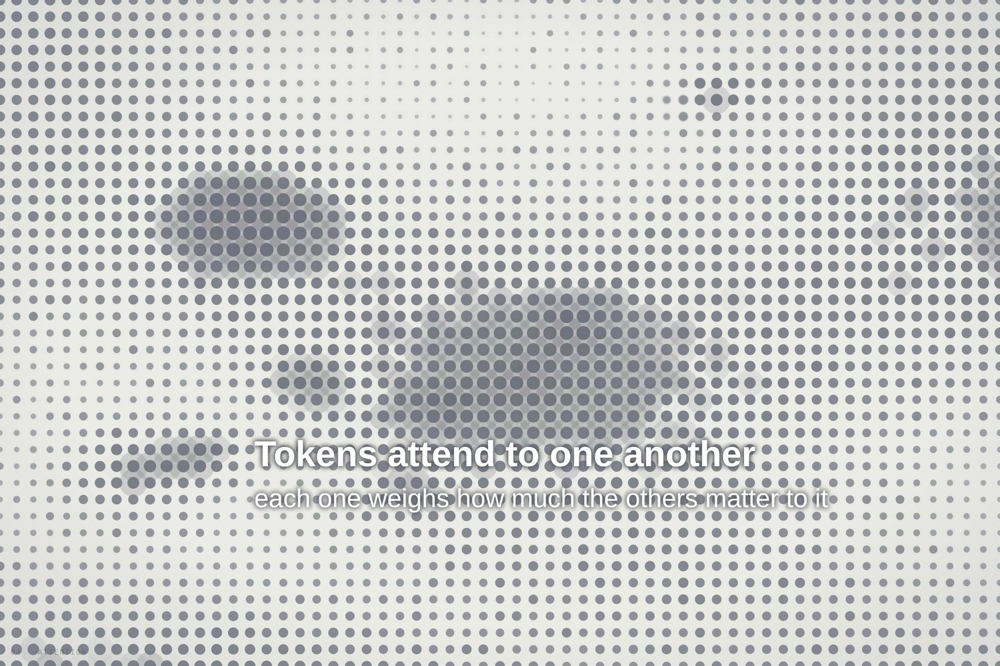
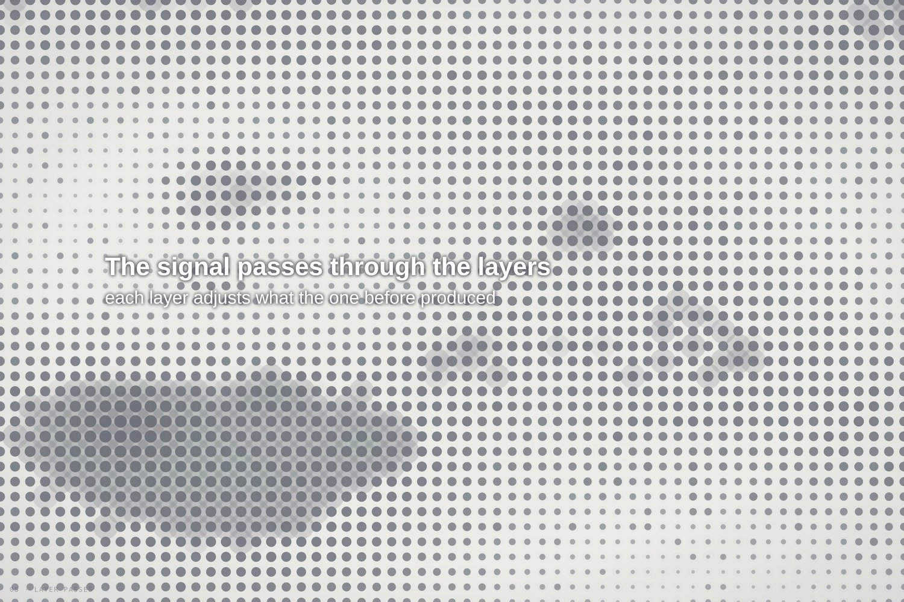
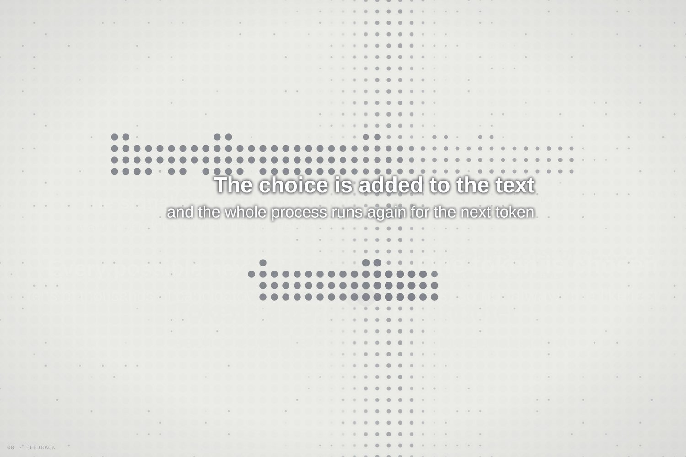

# Dot-Matrix Mind

**Visualising language-model generation as overlapping action**
Dan Bartlett · Independent Experimental Research · 2026

**[Open the piece →](https://barto86.github.io/dot-matrix-mind/)**

  
  

*Dot-Matrix Mind* is an animated visualisation of how a large language model turns a prompt into a reply. Everything on screen is made from one material, a grid of dots, and the stages of generation are shown through the way those dots brighten and move.

## Why I made this

When language models are explained to students, the explanation is usually a block diagram: labelled boxes joined by arrows. These diagrams are accurate, and I use them, but they suggest a production line in which each stage finishes before the next begins. Three-dimensional walkthroughs show the model in motion and in far more detail, but they ask for more time than a passing viewer has.

Much of my working life in animation has been about timing, and in particular about when one movement starts while another is still settling. Thomas and Johnston (1981) called this overlapping action, and it is a large part of why animated movement feels natural. I wanted to see how a language model would look if its stages were timed in the same way.

The visual language comes from dot-matrix and LED displays, the signboards and early screens that built letters from points of light. Because the text and the computation are drawn in the same dots, the prompt can be seen dissolving into the process and the reply forming out of it.

## The eight stages

Each stage has a window in a 48-second loop. The windows overlap, and a low level of activity runs underneath all of them, so the field never goes completely still.

| | Stage | What you see |
| --- | --- | --- |
| 01 | Prompt | A line sweeps across the field and the prompt appears behind it, written in dots |
| 02 | Tokenisation | The prompt is divided into tokens, shown as labelled tags |
| 03 | Embedding | Each token becomes a list of numbers; the field turns into a slow, drifting pattern |
| 04 | Attention | Points of light travel between nodes as each token weighs the others |
| 05 | Layer passes | Waves cross the field as the signal moves through the stack of layers |
| 06 | Probability | A flickering cloud: the scores for each token that could come next |
| 07 | Sampling | One point brightens and the rest of the cloud fades |
| 08 | Feedback | The choice is written out in dots and added to the text |

  
  

## What is real and what is illustrative

- **Real:** the order of the stages, and the word-by-word way a reply is generated, with each new token fed back in for another pass.
- **Illustrative:** everything else. The piece does not run a model. The prompt, tokens and reply are fixed, the token splits were chosen by hand, and the attention links, candidate cloud and layer waves are drawn to suggest each stage rather than measured from a model. The background flicker is a visual device.
- The poster sets out, stage by stage, how the animation differs from what happens in a real model.

## Trying it

- **In a browser:** use the link at the top of this page.
- **Offline:** download `index.html` and open it in any current browser. It is a single file with no libraries, so it runs without an internet connection.
- **Exhibition (kiosk) mode on a Mac:** quit Chrome, then run
  `open -na "Google Chrome" --args --kiosk "file:///FULL/PATH/TO/index.html"`
  and press Cmd+Q to leave.

Click anywhere to pause or resume. The L key shows or hides the stage label.

To change the text, edit `PROMPT`, `TOKENS` and `OUTPUT` near the top of the script. `CAPTIONS` holds the eight stage captions and `TOTAL` sets the loop length in seconds.

## In this repository

| Path | What it is |
| --- | --- |
| `index.html` | The piece, as a single self-contained file (served by GitHub Pages) |
| `poster/` | The poster, as an A3 PDF and its editable HTML source |
| `docs/images/` | Frames captured from the piece, used on this page |

## Credits

Written in plain JavaScript and HTML Canvas, with no libraries. The poster uses Gelasio and Courier Prime, both under the SIL Open Font Licence. Developed with coding assistance from Claude.

Key references: Thomas and Johnston (1981), *The Illusion of Life*; Vaswani et al. (2017), *Attention Is All You Need*; Bender et al. (2021), *On the Dangers of Stochastic Parrots*; Alammar (2018), *The Illustrated Transformer*; Bycroft (2023), *LLM Visualization*.

Companion piece: [Ninety-Two Layers](https://github.com/Barto86/ninety-two-layers).

© 2026 Dan Bartlett. All rights reserved for the text, images and design. Third-party fonts remain under their own licences.
